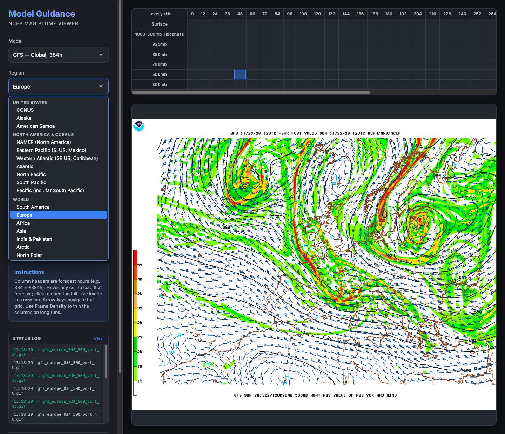

# NCEP Model Guidance (MAG) Viewer

An interactive, high-performance web dashboard for visualizing NCEP Model Guidance (MAG) meteorological charts. Designed for meteorologists who need fast, seamless access to forecast imagery across multiple atmospheric levels and forecast hours.

*Hover over a cell in the grid to show that chart; here, the GFS 500 mb chart for Europe at +48 h. The Region menu (shown open) lists every region MAG plots for the selected model, and the Status Log at the bottom left lists each chart as it loads (drag its corner to make it taller).*

## 🚀 Key Features

- **Interactive Hover Grid**: Navigate through hundreds of forecast hours and multiple pressure levels just by moving your mouse. No clicking required.
- **Smart Profile Mode**: Automatically resolves the most scientifically relevant product for each level (e.g., MSLP/Wind at surface, Vorticity at 500mb, Jets at 300mb).
- **Run Progress Monitoring**: Real-time background scanning of NCEP servers to detect exactly how far the current model run has progressed, including a "Smart Freshness" check to prevent viewing yesterday's stale data.
- **Keyboard Navigation**: Use arrow keys to explore the atmosphere and time-steps with precision.
- **Current NCEP Models**: GFS, AIGFS, RRFS, HRRR, RAP, and GEFS Mean/Spread (see the table below).
- **Every MAG Region**: Each model offers all the regions MAG plots for it, grouped in the menu: CONUS and the six US sectors (Southeast, South Central, Northeast, North Central, Northwest, Southwest), Alaska, Hawaii and Puerto Rico; North America and the surrounding oceans; and the rest of the world (South America, Europe, Africa, Asia, India, Arctic, North Polar).
- **Cross-Level Consistency**: Synchronized viewing allows you to maintain the same forecast hour while switching between atmospheric parameters.
- **Frame Density**: Thin long runs to 3-, 6- or 12-hourly columns so they fit without horizontal scrolling.

## 🌐 Models

| Model | Type | Cycles (UTC) | Forecast range | Regions |
|---|---|---|---|---|
| GFS | Global | 00/06/12/18 | 384 h (3-hourly to 240 h, 12-hourly after) | 17: NAMER, CONUS, Alaska, American Samoa, the Atlantic and Pacific domains, South America, Europe, Africa, Asia, India, Arctic, North Polar |
| AIGFS | Global, AI-based (NOAA's Artificial Intelligence GFS) | 00/06/12/18 | 384 h, 6-hourly | Same 17 as GFS |
| RRFS | Regional, convection-allowing (replaced NAM) | 00/06/12/18 | 84 h, hourly | CONUS, 6 US sectors, Alaska, Hawaii, Puerto Rico |
| HRRR | Regional, convection-allowing | Hourly (Alaska every 3 h) | 48 h at 00/06/12/18Z, 18 h otherwise | CONUS, 6 US sectors, Alaska |
| RAP | Regional | Hourly | 51 h at 03/09/15/21Z, 21 h otherwise | CONUS, NAMER |
| GEFS Mean/Spread | Global ensemble | 00/06/12/18 | 384 h (6-hourly to 180 h, 12-hourly after) | Same as GFS except American Samoa and the far South Pacific |

Precipitation uses the accumulation period each model publishes on MAG at that hour: 1 h for HRRR, RAP and RRFS; 3 h for GFS (12 h past 240 h); 6 h for AIGFS and GEFS. MAG plots no GFS or AIGFS precipitation on the North Polar domain, so those cells are greyed out.

AIGFS's outer domains (Alaska, Arctic, India, the Pacific domains, American Samoa) finish up to about an hour after its NAMER/CONUS charts, so Run Progress may show them as still in progress for a while.

### Model changes

- **November 2026 (MAG 7.1.0)**: NWS retired the **NAM** and **SREF** (SCN 26-47), and MAG stopped serving them. **RRFS** replaces the NAM in this viewer; anyone whose last-used model was NAM now opens on RRFS. SREF's replacement, **REFS**, is on MAG, but it only publishes ensemble probability fields, with no pressure-level charts for the level-by-hour grid, so it isn't included here.
- **August 2026 (MAG 7.0.0)**: MAG added the **AIGFS**, which this viewer added in November 2026.

## 📍 Point Forecasts

The tabs along the top go beyond the MAG charts to forecasts for one place. Type a ZIP or `City, ST` once and every tab uses it; it is remembered in your browser (default Jackson, MS). A tab loads its data only when you open it, and the address keeps the tab (for example `#winter`) so you can link to it.

| Tab | What it shows | Source |
|---|---|---|
| Charts | The MAG grid described above | NCEP MAG |
| Model Comparison | 11 models on one chart (temperature, dewpoint, wind, precip or MSLP, 3 to 15 days), each with its run time, plus the spread between them. Click a model to hide it; hover or tap for values | Open-Meteo |
| MOS | GFS MOS (MAV), GFS Extended (MEX), LAMP, and NBM short and extended bulletins for the nearest airport that issues them (within 100 miles), or any station you type. A−/A+ changes the text size | Iowa Environmental Mesonet (MDL bulletins); NWS station list |
| Soundings | HRRR or GFS forecast skew-T and hodograph for any hour, with SB/ML/MU parcels, shear, SRH, composites and thermodynamics. Forecast soundings only | Open-Meteo |
| Winter | Snow (Kuchera or fixed ratio), sleet, flat and radial ice (FRAM) and precip type from RRFS, HRRR, RAP, GFS and ECMWF, with the NWS forecast, the odds of snow from three ensembles, and the previous runs | IEM BUFKIT, Open-Meteo, NWS |

Good to know:

- There is no NAM MOS: it ended with the NAM on November 3, 2026 (SCN 26-47). There is also no standalone HRRR MOS; LAMP is the HRRR-based station guidance.
- NOAA's AI models (AIGFS, AIGEFS, HGEFS) publish no humidity, so they have no dewpoint line.
- Winter amounts assume no melting or compaction, so they run high on warm ground. Model profiles come from the nearest BUFKIT site; sites more than 100 miles away are not used.
- HRRR, RRFS and RAP are short-range, so their lines end early.

These tabs are copied from FX-Net NextGen, and use the same formulas.

## 🧪 Tests

`node --test` from the project folder (Node 18 or newer; nothing to install).

## 🛠 Tech Stack

- **Frontend**: Vanilla HTML5, CSS3 (Glassmorphism UI), and Modern JavaScript.
- **Data Source**: Live imagery via NOAA/NCEP Model Analyses and Guidance (MAG). Point forecasts from Open-Meteo.com (CC BY 4.0), the Iowa Environmental Mesonet and the National Weather Service; ZIP lookup by Zippopotam.us.
- **Code**: `app.js` is the chart grid; `point/` holds the point-forecast tabs, one file each. A strict Content-Security-Policy in `index.html` lists every host the page may contact, so a new data source must be added there.
- **Zero Dependencies**: Pure client-side application—no backend or external libraries required.

## 🌍 Live Demo

Access the interactive dashboard here:  
**[https://cuevman81.github.io/ncep-mag-viewer/](https://cuevman81.github.io/ncep-mag-viewer/)**

## 👨‍🔬 Developed By

**Rodney Cuevas**, Meteorologist  
*Mississippi Department of Environmental Quality*  
[RCuevas@mdeq.ms.gov](mailto:RCuevas@mdeq.ms.gov)

## ⚖️ License

This project is licensed under the MIT License - see the [LICENSE](LICENSE) file for details.

---
*Data provided courtesy of NOAA/NCEP and MDL. Model data by Open-Meteo.com (CC BY 4.0). MOS and BUFKIT via Iowa Environmental Mesonet. This tool is not an official NOAA product.*
